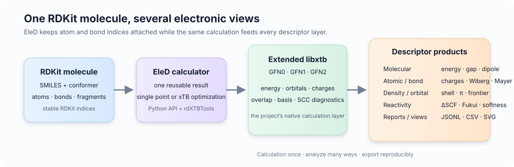
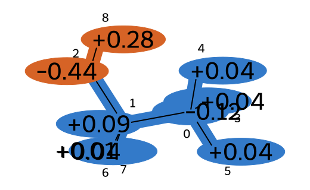
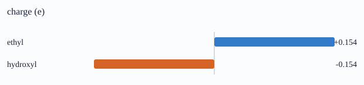
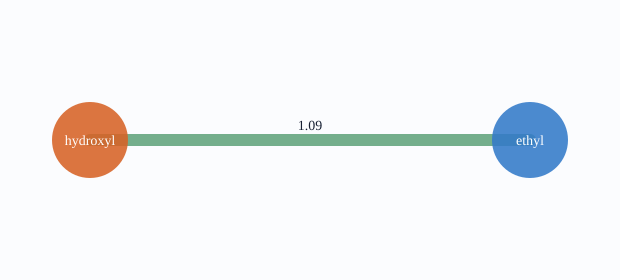

# EleD

<p align="center">
  <strong>Electronic-structure descriptors for RDKit molecules</strong><br>
  <em>From an RDKit graph and one 3D conformer to reusable xTB descriptors, reports and visual maps.</em>
</p>

<p align="center">
  <a href="README.zh-CN.md">中文</a> ·
  <a href="docs/README.md">Documentation</a> ·
  <a href="https://github.com/iawnix/EleD/issues">Issues</a>
</p>

<p align="center">
  
  
  
  
</p>

EleD is an RDKit extension for electronic-structure descriptors. The RDKit molecule stays at the center: atom and bond indices, conformers, fragments and annotations remain connected while EleD runs the project's extended `libxtb` backend and turns one calculation into several analysis views.



## Why EleD?

RDKit is excellent at representing molecular structure. xTB is excellent at producing fast approximate electronic structure. EleD joins those two layers in a reusable API so that a calculation can be inspected at molecular, atomic, bond, fragment, density and reactivity levels without losing the original RDKit indexing.

The core flow is simple:

```text
RDKit Mol + 3D conformer
        │
        ▼
  XTBCalculator  ──►  extended libxtb (GFN0 / GFN1 / GFN2)
        │
        ├── molecular, atomic and bond descriptors
        ├── density and frontier-orbital analysis
        ├── fixed-geometry ΔSCF reactivity
        └── versioned reports, CSV/JSONL and SVG views
```

## A five-minute calculation

```python
from rdkit import Chem
from rdkit.Chem import AllChem
from eled import XTBCalculator, CalcXTBDescriptors

mol = Chem.AddHs(Chem.MolFromSmiles("CCO"))
if AllChem.EmbedMolecule(mol, randomSeed=1) != 0:
    raise RuntimeError("could not generate a conformer")
AllChem.MMFFOptimizeMolecule(mol)

result = XTBCalculator(method="GFN2-xTB").calculate(mol)
values = CalcXTBDescriptors(result)

print(values["xtb_energy_ha"])
print(values["xtb_homo_ev"], values["xtb_lumo_ev"], values["xtb_gap_ev"])
```

`XTBResult` is reusable. The same result can feed descriptor tables, fragment summaries, density analysis and a report, so repeated analysis does not silently repeat the engine call.

## What you get

| Layer | Examples | Main entry points |
| --- | --- | --- |
| Molecular | energy, HOMO/LUMO, gap, dipole, charge statistics | `CalcXTBDescriptors` |
| Atomic | xTB charge, Wiberg sum, Fukui and local reactivity | `CalcXTBAtomDescriptors`, `RunReactivity` |
| Bond | Wiberg and Mayer bond orders, frontier-bond contributions | `CalcXTBBondDescriptors`, `CalcMayerBondDescriptors`, `CalcFrontierBondDescriptors` |
| Density | Mulliken/Löwdin shell populations, density matrix, π population and π bond order | `CalcDensityMatrix`, `CalcShellPopulations`, `CalcPiDescriptors` |
| Frontier orbitals | degenerate HOMO/LUMO groups, participation, centroids and bond decomposition | `CalcFrontierDescriptors`, `CalcFrontierBondDescriptors` |
| Conformers | mean, standard deviation, range and optional electronic-energy weighting | `RunConformerAnalysis` |
| Reports | provenance, units, quality flags, missing-value reasons and JSONL/CSV export | `CalcDescriptorReport`, `ExportDescriptorReports` |

## See an actual output

The following images were generated from an EleD GFN2-xTB single point on an embedded ethanol conformer. The molecular map is drawn with RDKit's `rdMolDraw2D`; the fragment charts are dependency-free SVG returned by EleD.

<p align="center">
  
</p>

<p align="center">
  
</p>
<p align="center">
  
</p>

A report keeps the numerical data behind those views:

```python
from eled import (
    CalcDescriptorReport, DrawDescriptorMap, PlotFragmentSummary,
    PlotFragmentInteractions,
)

report = CalcDescriptorReport(
    mol,
    result,
    record_id="ethanol",
    fragments={"ethyl": [0, 1, 3, 4, 5, 6, 7], "hydroxyl": [2, 8]},
)

molecule_svg = DrawDescriptorMap(mol, report, atom_field="q_e")
fragment_svg = PlotFragmentSummary(report, field="q_e")
network_svg = PlotFragmentInteractions(report)
```

## Density and orbital analysis

Retain the overlap and basis mapping when the calculation needs density-derived features:

```python
from eled import (
    XTBCalculator, CalcOrbitalPopulations, CalcDensityMatrix,
    CalcShellPopulations, CalcMayerBondDescriptors,
    CalcFrontierBondDescriptors, CalcPiDescriptors,
)

result = XTBCalculator(method="GFN2-xTB").calculate(mol, keep_overlap=True)

mulliken = CalcOrbitalPopulations(result, scheme="mulliken")
lowdin = CalcOrbitalPopulations(result, scheme="lowdin")
density = CalcDensityMatrix(result)
shells = CalcShellPopulations(result)
mayer = CalcMayerBondDescriptors(mol, result)
frontier_bonds = CalcFrontierBondDescriptors(mol, result)
pi = CalcPiDescriptors(mol, result)
```

The density layer consumes the retained result; it does not start another xTB calculation. Units, invariance conventions and missing-value semantics are documented in the [descriptor catalog](docs/descriptor-catalog.md) and [density descriptor guide](docs/density-descriptors.md).

## Reactivity and geometry

`RunReactivity` evaluates matched charge states at the supplied geometry and returns ΔSCF ionization/attachment energies, global hardness and softness, Fukui functions and local conceptual-DFT indices. `PrepareConformers` provides RDKit embedding and force-field refinement; `OptimizeXTB` can then refine a geometry with the same native backend used for descriptors.

```python
from eled import RunReactivity, XTBOptions

reactivity = RunReactivity(
    mol,
    options=XTBOptions(method="GFN2-xTB", electronic_temperature=300.0),
    population_scheme="lowdin",
)
print(reactivity["values"]["ip_v_ev"])
print(reactivity["atoms"][0]["f_plus"])
```

## Install

The supported Linux x86-64 profile installs RDKit, EleD, the project-built extended `libxtb` and the optional `rdXTBTools` extension as one matched runtime:

```bash
git clone https://github.com/iawnix/EleD.git
cd EleD
python tools/install_native.py --jobs 6
conda activate "$PWD/.eled/runtime"
python -m eled doctor --check compiled --method GFN2-xTB
```

`--jobs` controls parallel build jobs; it does not change the numerical calculation. See the [installation guide](docs/install.md) for source builds and runtime layout.

## Documentation

- [Start here: documentation index](docs/README.md)
- [Descriptor definitions and units](docs/descriptors.md)
- [Descriptor catalog](docs/descriptor-catalog.md)
- [Reports, quality and exports](docs/descriptor-reports.md)
- [Visualization](docs/visualization.md)
- [Geometry preparation](docs/geometry-preparation.md)
- [xTB geometry optimization](docs/geometry-preparation.md)
- [C++ interface](docs/rdxtb-tools.md)
- [Native backend build](docs/xtb-patched-build.md)

Model training and benchmark datasets live in a separate `benchmarks/` layer. They are not required to calculate descriptors or to run the core test suite.

## Scope

EleD provides ground-state, gas-phase electronic descriptors and fixed-geometry ΔSCF reactivity built around RDKit molecules. It does not present frontier-orbital proxies as excited-state observables, and it does not include a solvent model or an excited-state solver.

The YAeHMOP/EHT adapter remains available as an independent RDKit comparison path. It is not the xTB backend used by EleD's descriptor protocol.

## Contributing and license

Development setup and test commands are in the [development guide](docs/development.md). Contributions that improve descriptor definitions, native reproducibility, RDKit integration or documentation are welcome.

EleD is released under the BSD 3-Clause license. The bundled xTB source and patches retain their upstream licenses.
