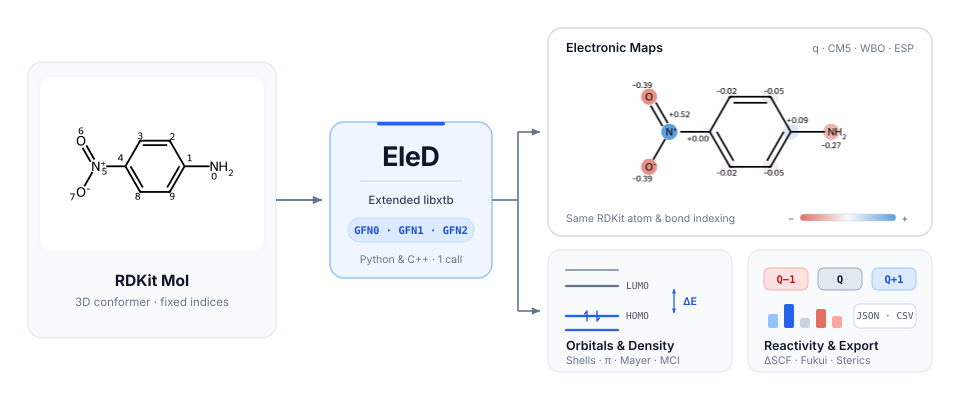
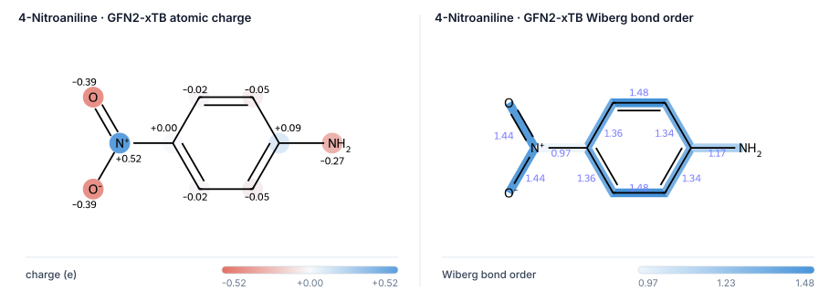

# EleD

<p align="center">
  <strong>Electronic-structure descriptors for RDKit molecules</strong><br>
  <em>From an RDKit graph and one 3D conformer to reusable xTB descriptors, reports and visual maps.</em>
</p>

<p align="center">
  <a href="README.zh-CN.md">中文</a> ·
  <a href="docs/README.md">Documentation</a> ·
  <a href="https://github.com/iawnix/EleD/issues">Issues</a>
</p>

<p align="center">
  
  
  
  
</p>

EleD is an RDKit extension for electronic-structure descriptors. The RDKit molecule stays at the center: atom and bond indices, conformers, fragments and annotations remain connected while EleD runs the project's extended `libxtb` backend and turns one calculation into several analysis views.

<p align="center">
  
</p>

## Why EleD?

RDKit is excellent at representing molecular structure. xTB is excellent at producing fast approximate electronic structure. EleD joins those two layers in a reusable API so that one calculation can be inspected at molecular, atomic, bond, fragment, density and reactivity levels while preserving the original RDKit indexing.

## A five-minute calculation

```python
from rdkit import Chem
from rdkit.Chem import AllChem
from eled import XTBCalculator, CalcXTBDescriptors

mol = Chem.AddHs(Chem.MolFromSmiles("CCO"))
if AllChem.EmbedMolecule(mol, randomSeed=1) != 0:
    raise RuntimeError("could not generate a conformer")
AllChem.MMFFOptimizeMolecule(mol)

result = XTBCalculator(method="GFN2-xTB").Calculate(mol)
values = CalcXTBDescriptors(result)

print(values["xtb_energy_ha"])
print(values["xtb_homo_ev"], values["xtb_lumo_ev"], values["xtb_gap_ev"])
```

`XTBResults` is reusable. The same result feeds descriptor tables, fragment summaries, density analysis and a report, with one recorded engine call. For single-call molecular tables or RDKit's property registry, use `CalcMolXTBDescriptors(mol)` or `RegisterRDKitProperties()`.

## What you get

| Layer | Examples | Main entry points |
| --- | --- | --- |
| Molecular | energy, HOMO/LUMO, gap, dipole, charge statistics, `rdMolDescriptors.Properties` | `CalcXTBDescriptors`, `CalcMolXTBDescriptors`, `RegisterRDKitProperties` |
| Extended properties | energy decomposition, Fermi levels, D4 polarizability/C6/C8, CAMM atomic & molecular multipoles, exact nuclear ESP (EPN) | `CalcEnergyDecomposition`, `CalcPolarizabilityDescriptors`, `CalcMultipoleDescriptors`, `CalcNuclearESP` |
| Atomic | xTB/CM5 charges, Wiberg sum, ΔSCF & orbital-weighted Fukui, Gázquez $\omega^\pm$/$S^2\Delta f$, condensed ALIE/PDOS, FOD & linear response $\chi_{AB}$ | `CalcXTBAtomDescriptors`, `RunReactivity`, `CalcOrbitalWeightedFukui`, `CalcAtomicOrbitalEnergies`, `RunFOD`, `CalcLinearResponseMatrix` |
| [ESP, surfaces & real-space](docs/esp-api.md) | sampled ESP, Politzer–Murray vdW-shell & `0.001 a.u.` isosurface ESP/ALIE/LEA/volume/area, directed σ/π-hole & HBD/HBA extrema, valence ELF/LOL & NCI/RDG, constrained ESP/RESP charges | `GenerateESPGrid`, `GenerateESPSurfaceGrid`, `CalcESP`, `CalcESPSurfaceDescriptors`, `CalcRealSpaceProperties`, `CalcRealSpaceSurfaceDescriptors`, `CalcDensityIsosurface`, `CalcDirectedSurfaceDescriptors`, `CalcRealSpaceTopology`, `CalcNCIDescriptors`, `FitESPCharges`, `FitRESPCharges` |
| Bond | Wiberg bond orders, frontier-bond overlap, COOP/ECOHP, bond polarity, bond electric fields, valence bond topology/ellipticity & Cremer–Kraka local force constants | `CalcXTBBondDescriptors`, `CalcFrontierBondDescriptors`, `CalcBondOverlapDescriptors`, `CalcBondElectricField`, `CalcBondDensityTopology`, `CalcLocalBondForceConstants` |
| Fragment EDA | fragment charges/WBOs, fixed-geometry interaction energy decomposition (EDA), charge transfer & inter-fragment COOP/ECOHP/$\chi_{AB}$ | `CalcXTBFragmentDescriptors`, `CalcFragmentInteraction` |
| Density & LMOs | Mulliken/Löwdin shell populations, density matrix, π descriptors, Pipek–Mezey localized orbitals | `CalcDensityMatrix`, `CalcShellPopulations`, `CalcPiDescriptors`, `CalcLocalizedOrbitals` |
| Frontier orbitals | degenerate HOMO/LUMO groups, participation, centroids and bond decomposition | `CalcFrontierDescriptors`, `CalcFrontierBondDescriptors` |
| Solvation & thermochemistry | ALPB/GBSA implicit solvation shifts, harmonic frequencies, IR intensities & RRHO/qRRHO thermochemistry | `CalcSolvationDescriptors`, `CalcVibrationalThermochemistry` |
| Conformers | mean, standard deviation, range and optional electronic-energy weighting | `RunConformerAnalysis` |
| Reports | provenance, units, quality flags, missing-value reasons and JSONL/CSV export | `CalcDescriptorReport`, `ExportDescriptorReports` |

## Visualizing descriptors on an RDKit molecule

One GFN2-xTB calculation feeds both atomic and bond maps directly on the RDKit 2D structure while preserving original atom/bond indices and element symbols:

<p align="center">
  
</p>

```python
from rdkit import Chem
from rdkit.Chem import AllChem
from eled import XTBCalculator, CalcDescriptorReport, DrawDescriptorMap

mol = Chem.AddHs(Chem.MolFromSmiles("Nc1ccc([N+](=O)[O-])cc1"))
AllChem.EmbedMolecule(mol, randomSeed=42)
AllChem.MMFFOptimizeMolecule(mol)

result = XTBCalculator(method="GFN2-xTB").Calculate(mol)
report = CalcDescriptorReport(mol, result, recordId="4-nitroaniline")

charge_svg = DrawDescriptorMap(mol, report, atomField="q_e")
bond_svg = DrawDescriptorMap(mol, report, bondField="wbo")
```

## Density and orbital analysis

Retain the overlap and basis mapping when the calculation needs density-derived features:

```python
from eled import (
    XTBCalculator, CalcOrbitalPopulations, CalcDensityMatrix,
    CalcShellPopulations, CalcFrontierBondDescriptors, CalcPiDescriptors,
)

result = XTBCalculator(method="GFN2-xTB").Calculate(mol, keepOverlap=True)

mulliken = CalcOrbitalPopulations(result, scheme="mulliken")
lowdin = CalcOrbitalPopulations(result, scheme="lowdin")
density = CalcDensityMatrix(result)
shells = CalcShellPopulations(result)
frontier_bonds = CalcFrontierBondDescriptors(mol, result)
pi = CalcPiDescriptors(mol, result)
```

The density layer consumes the retained result and records the same xTB calculation. Units, invariance conventions and missing-value semantics are documented in the [descriptor catalog](docs/descriptor-catalog.md) and [density descriptor guide](docs/density-descriptors.md).

## Reactivity and geometry

`RunReactivity` evaluates matched charge states at the supplied geometry and returns ΔSCF ionization/attachment energies, global hardness and softness, Fukui functions and local conceptual-DFT indices. `PrepareConformers` provides RDKit embedding and force-field refinement; `OptimizeXTB` can then refine a geometry with the same native backend used for descriptors.

```python
from eled import RunReactivity, XTBOptions

reactivity = RunReactivity(
    mol,
    options=XTBOptions(method="GFN2-xTB", electronicTemperature=300.0),
    populationScheme="lowdin",
)
print(reactivity["values"]["ip_v_ev"])
print(reactivity["atoms"][0]["f_plus"])
```

## Install

The supported Linux x86-64 profile installs RDKit, EleD, the project-built extended `libxtb` and the optional `rdXTBTools` extension as one matched runtime:

```bash
git clone https://github.com/iawnix/EleD.git
cd EleD
python tools/install_native.py --jobs 6
conda activate "$PWD/.eled/runtime"
python -m eled doctor --check compiled --method GFN2-xTB
```

`--jobs` controls parallel build jobs; the numerical calculation follows the selected method and options. See the [installation guide](docs/install.md) for source builds and runtime layout.

## Documentation

- [Start here: documentation index](docs/README.md)
- [Descriptor definitions and units](docs/descriptors.md)
- [Descriptor catalog](docs/descriptor-catalog.md)
- [ESP and fitted charges](docs/esp-api.md)
- [Local steric and ring geometry](docs/local-geometry.md)
- [Reports, quality and exports](docs/descriptor-reports.md)
- [Visualization](docs/visualization.md)
- [Geometry preparation and xTB optimization](docs/geometry-preparation.md)
- [C++ interface](docs/rdxtb-tools.md)
- [Native backend build](docs/xtb-patched-build.md)
- [Research and case-study plan](docs/research-plan-eled.md)
- [Multi-model application plan](docs/research-plan-ml.md)

Application model training, datasets and trained artifacts are maintained outside
the EleD repository. The public package supplies descriptor reports and feature
archives that an external study can consume.

## Scope

EleD provides ground-state electronic descriptors, fixed-geometry ΔSCF and orbital-weighted reactivity, optional ALPB/GBSA implicit solvation, and harmonic RRHO/qRRHO vibrational thermochemistry built around RDKit molecules. Frontier-orbital descriptors describe the ground-state calculation; excited-state solvers and periodic solids remain outside scope.

## Contributing and license

Development setup and test commands are in the [development guide](docs/development.md). Contributions that improve descriptor definitions, native reproducibility, RDKit integration or documentation are welcome.

EleD is released under the BSD 3-Clause license. The bundled xTB source and patches retain their upstream licenses.
