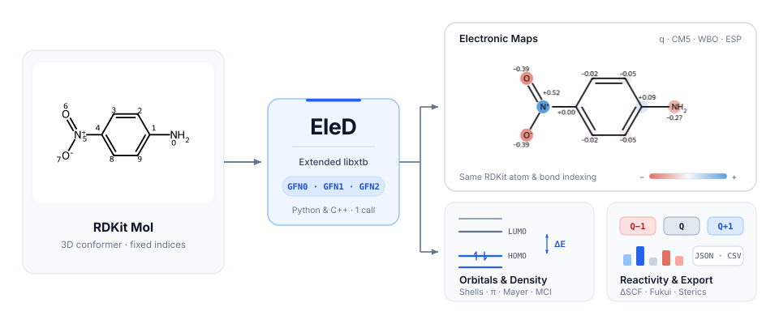
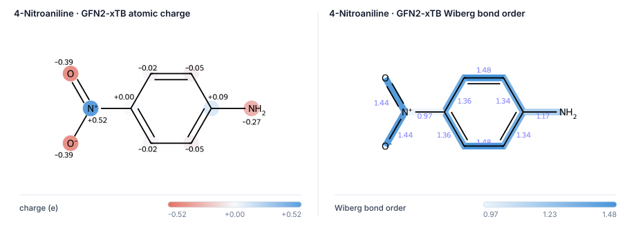

# EleD

<p align="center">
  <strong>面向 RDKit 分子的电子结构描述符扩展</strong><br>
  <em>从 RDKit 分子图和一个三维构象，得到可复用的 xTB 描述符、报告和可视化。</em>
</p>

<p align="center">
  <a href="README.md">English</a> ·
  <a href="docs/README.md">文档</a> ·
  <a href="https://github.com/iawnix/EleD/issues">问题反馈</a>
</p>

<p align="center">
  
  
  
  
</p>

EleD 是 RDKit 的电子结构描述符扩展。RDKit 分子对象始终是中心：原子和键编号、构象、片段以及注释会贯穿 EleD 的项目扩展版 `libxtb` 计算，并连接到分子级、原子级、键级、密度和反应性分析。

<p align="center">
  
</p>

## EleD 解决什么问题？

RDKit 擅长表示分子结构，xTB 擅长快速给出近似电子结构。EleD 将这两层连接起来，使一次计算能够在多个层级上复用，同时保留原始 RDKit 原子编号和键编号。

## 五分钟示例

```python
from rdkit import Chem
from rdkit.Chem import AllChem
from eled import XTBCalculator, CalcXTBDescriptors

mol = Chem.AddHs(Chem.MolFromSmiles("CCO"))
if AllChem.EmbedMolecule(mol, randomSeed=1) != 0:
    raise RuntimeError("could not generate a conformer")
AllChem.MMFFOptimizeMolecule(mol)

result = XTBCalculator(method="GFN2-xTB").Calculate(mol)
values = CalcXTBDescriptors(result)

print(values["xtb_energy_ha"])
print(values["xtb_homo_ev"], values["xtb_lumo_ev"], values["xtb_gap_ev"])
```

`XTBResults` 可以重复使用。同一个结果可以继续生成描述符表、片段汇总、密度分析和报告，所有视图共享同一次已记录的引擎计算。如果只需要一步提取分子标量字典或注册到 RDKit 属性表，可使用 `CalcMolXTBDescriptors(mol)` 或 `RegisterRDKitProperties()`。

## 可以得到什么？

| 层级 | 示例 | 主要入口 |
| --- | --- | --- |
| 分子级 | 能量、HOMO/LUMO、能隙、偶极矩、电荷统计、`rdMolDescriptors.Properties` | `CalcXTBDescriptors`、`CalcMolXTBDescriptors`、`RegisterRDKitProperties` |
| 扩展性质 | 能量分解、费米能级、D4 极化率/C6/C8、CAMM 原子与分子多极矩、精确原子核静电势（EPN） | `CalcEnergyDecomposition`、`CalcPolarizabilityDescriptors`、`CalcMultipoleDescriptors`、`CalcNuclearESP` |
| 原子级 | xTB/CM5 电荷、Wiberg 总和、ΔSCF 与轨道加权 Fukui、凝聚态 ALIE 与 PDOS | `CalcXTBAtomDescriptors`、`RunReactivity`、`CalcOrbitalWeightedFukui`、`CalcAtomicOrbitalEnergies` |
| [静电势、表面与电荷](docs/zh-CN/esp-api.md) | 静电势采样、Politzer–Murray 范德华壳层表面统计、ESP/单阶段 RESP 拟合电荷 | `GenerateESPGrid`、`GenerateESPSurfaceGrid`、`CalcESP`、`CalcESPSurfaceDescriptors`、`FitESPCharges`、`FitRESPCharges` |
| 键级 | Wiberg/Mayer 键级、前线键重叠、COOP/ECOHP 与键极性 | `CalcXTBBondDescriptors`、`CalcMayerBondDescriptors`、`CalcFrontierBondDescriptors`、`CalcBondOverlapDescriptors` |
| 密度与局域轨道 | Mulliken/Löwdin shell 布居、密度矩阵、π 描述符、Pipek–Mezey 局域轨道（LMO） | `CalcDensityMatrix`、`CalcShellPopulations`、`CalcPiDescriptors`、`CalcLocalizedOrbitals` |
| 前线轨道 | 简并 HOMO/LUMO 组、参与度、质心和键分解 | `CalcFrontierDescriptors`、`CalcFrontierBondDescriptors` |
| 溶剂化与热化学 | ALPB/GBSA 隐式溶剂化位移、谐振频率、红外强度与 RRHO/qRRHO 热化学 | `CalcSolvationDescriptors`、`CalcVibrationalThermochemistry` |
| 构象 | 均值、标准差、范围以及可选的电子能加权 | `RunConformerAnalysis` |
| 报告 | 来源、单位、质量标记、缺失原因以及 JSONL/CSV 导出 | `CalcDescriptorReport`、`ExportDescriptorReports` |

## 在 RDKit 分子上直接可视化描述符

同一次 GFN2-xTB 单点计算可以直接在 RDKit 二维分子图上渲染原子级和键级描述符，同时保留原始原子/键编号与元素符号：

<p align="center">
  
</p>

```python
from rdkit import Chem
from rdkit.Chem import AllChem
from eled import XTBCalculator, CalcDescriptorReport, DrawDescriptorMap

mol = Chem.AddHs(Chem.MolFromSmiles("Nc1ccc([N+](=O)[O-])cc1"))
AllChem.EmbedMolecule(mol, randomSeed=42)
AllChem.MMFFOptimizeMolecule(mol)

result = XTBCalculator(method="GFN2-xTB").Calculate(mol)
report = CalcDescriptorReport(mol, result, recordId="4-nitroaniline")

charge_svg = DrawDescriptorMap(mol, report, atomField="q_e")
bond_svg = DrawDescriptorMap(mol, report, bondField="wbo")
```

## 密度和轨道分析

需要密度相关特征时，在计算中保留重叠矩阵和基组映射：

```python
from eled import (
    XTBCalculator, CalcOrbitalPopulations, CalcDensityMatrix,
    CalcShellPopulations, CalcMayerBondDescriptors,
    CalcFrontierBondDescriptors, CalcPiDescriptors,
)

result = XTBCalculator(method="GFN2-xTB").Calculate(mol, keepOverlap=True)

mulliken = CalcOrbitalPopulations(result, scheme="mulliken")
lowdin = CalcOrbitalPopulations(result, scheme="lowdin")
density = CalcDensityMatrix(result)
shells = CalcShellPopulations(result)
mayer = CalcMayerBondDescriptors(mol, result)
frontier_bonds = CalcFrontierBondDescriptors(mol, result)
pi = CalcPiDescriptors(mol, result)
```

密度层直接消费已经保留的数据并沿用同一次 xTB 计算。单位、不变性约定和缺失值语义见[描述符目录](docs/zh-CN/descriptor-catalog.md)和[密度描述符说明](docs/zh-CN/density-descriptors.md)。

## 反应性和几何

`RunReactivity` 在输入几何上计算匹配的电荷态，返回 ΔSCF 电离/附着能、全局硬度和软度、Fukui 函数以及局部概念 DFT 指数。`PrepareConformers` 提供 RDKit 构象生成和力场细化；`OptimizeXTB` 可以用相同的原生后端继续优化几何。

```python
from eled import RunReactivity, XTBOptions

reactivity = RunReactivity(
    mol,
    options=XTBOptions(method="GFN2-xTB", electronicTemperature=300.0),
    populationScheme="lowdin",
)
print(reactivity["values"]["ip_v_ev"])
print(reactivity["atoms"][0]["f_plus"])
```

## 安装

支持的 Linux x86-64 配置会在同一个匹配的运行环境中安装 RDKit、EleD、项目构建的扩展版 `libxtb` 和可选的 `rdXTBTools` 扩展：

```bash
git clone https://github.com/iawnix/EleD.git
cd EleD
python tools/install_native.py --jobs 6
conda activate "$PWD/.eled/runtime"
python -m eled doctor --check compiled --method GFN2-xTB
```

`--jobs` 控制并行编译任务数，不改变数值计算。源码构建和运行时布局见[安装说明](docs/zh-CN/install.md)。

## 文档

- [文档目录](docs/README.md)
- [描述符定义和单位](docs/zh-CN/descriptors.md)
- [描述符目录](docs/zh-CN/descriptor-catalog.md)
- [静电势与拟合电荷](docs/zh-CN/esp-api.md)
- [局部位阻与环几何](docs/zh-CN/local-geometry.md)
- [报告、质量检查和导出](docs/zh-CN/descriptor-reports.md)
- [可视化](docs/zh-CN/visualization.md)
- [构象准备与 xTB 几何优化](docs/zh-CN/geometry-preparation.md)
- [C++ 接口](docs/rdxtb-tools.md)
- [原生后端构建](docs/xtb-patched-build.md)
- [研究与案例方案](docs/zh-CN/research-plan-eled.md)
- [多模型应用方案](docs/zh-CN/research-plan-ml.md)

应用模型训练、数据集和训练产物放在 EleD 仓库之外维护。公开包提供描述符报告
和特征归档，外部研究工程可以直接消费这些产物。

## 项目边界

EleD 提供围绕 RDKit 分子的基态电子描述符、固定几何 ΔSCF 与轨道加权反应性、可选的 ALPB/GBSA 隐式溶剂化以及谐振 RRHO/qRRHO 热化学分析。前线轨道描述符对应基态计算；激发态求解器和周期性体系不在项目范围内。

YAeHMOP/EHT 适配器作为独立的 RDKit 对照路径保留；EleD 描述符协议使用扩展版 xTB 后端。

## 贡献和许可证

开发环境和测试命令见[开发指南](docs/zh-CN/development.md)。欢迎改进描述符定义、原生计算可复现性、RDKit 集成和文档。

EleD 采用 BSD 3-Clause 许可证；随项目提供的 xTB 源码和补丁遵循其上游许可证。
