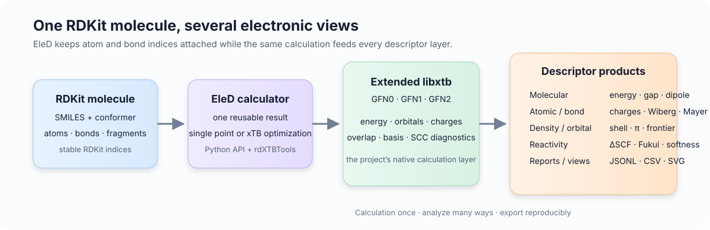
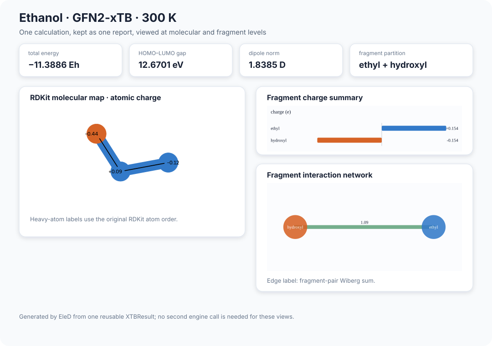

# EleD

<p align="center">
  <strong>面向 RDKit 分子的电子结构描述符扩展</strong><br>
  <em>从 RDKit 分子图和一个三维构象，得到可复用的 xTB 描述符、报告和可视化。</em>
</p>

<p align="center">
  <a href="README.md">English</a> ·
  <a href="docs/README.md">文档</a> ·
  <a href="https://github.com/iawnix/EleD/issues">问题反馈</a>
</p>

<p align="center">
  
  
  
  
</p>

EleD 是 RDKit 的电子结构描述符扩展。RDKit 分子对象始终是中心：原子和键编号、构象、片段以及注释会贯穿 EleD 的项目扩展版 `libxtb` 计算，并连接到分子级、原子级、键级、密度和反应性分析。



## EleD 解决什么问题？

RDKit 擅长表示分子结构，xTB 擅长快速给出近似电子结构。EleD 将这两层连接起来，使一次计算能够在多个层级上复用，同时保留原始 RDKit 原子编号和键编号。

核心流程如下：

```text
RDKit Mol + 三维构象
        │
        ▼
  XTBCalculator  ──►  扩展版 libxtb（GFN0 / GFN1 / GFN2）
        │
        ├── 分子、原子和键描述符
        ├── 密度和前线轨道分析
        ├── 固定几何的 ΔSCF 反应性
        └── 版本化报告、CSV/JSONL 和 SVG 视图
```

## 五分钟示例

```python
from rdkit import Chem
from rdkit.Chem import AllChem
from eled import XTBCalculator, CalcXTBDescriptors

mol = Chem.AddHs(Chem.MolFromSmiles("CCO"))
if AllChem.EmbedMolecule(mol, randomSeed=1) != 0:
    raise RuntimeError("could not generate a conformer")
AllChem.MMFFOptimizeMolecule(mol)

result = XTBCalculator(method="GFN2-xTB").calculate(mol)
values = CalcXTBDescriptors(result)

print(values["xtb_energy_ha"])
print(values["xtb_homo_ev"], values["xtb_lumo_ev"], values["xtb_gap_ev"])
```

`XTBResult` 可以重复使用。同一个结果可以继续生成描述符表、片段汇总、密度分析和报告，后续分析不会悄悄重复调用引擎。

## 可以得到什么？

| 层级 | 示例 | 主要入口 |
| --- | --- | --- |
| 分子级 | 能量、HOMO/LUMO、能隙、偶极矩、电荷统计 | `CalcXTBDescriptors` |
| 原子级 | xTB 电荷、Wiberg 总和、Fukui 函数和局部反应性 | `CalcXTBAtomDescriptors`、`RunReactivity` |
| 键级 | Wiberg/Mayer 键级、前线轨道键贡献 | `CalcXTBBondDescriptors`、`CalcMayerBondDescriptors`、`CalcFrontierBondDescriptors` |
| 密度 | Mulliken/Löwdin shell 布居、密度矩阵、π 布居和 π 键级 | `CalcDensityMatrix`、`CalcShellPopulations`、`CalcPiDescriptors` |
| 前线轨道 | 简并 HOMO/LUMO 组、参与度、质心和键分解 | `CalcFrontierDescriptors`、`CalcFrontierBondDescriptors` |
| 构象 | 均值、标准差、范围以及可选的电子能加权 | `RunConformerAnalysis` |
| 报告 | 来源、单位、质量标记、缺失原因以及 JSONL/CSV 导出 | `CalcDescriptorReport`、`ExportDescriptorReports` |

## 看一个实际输出

下面的报告只来自一个嵌入后的乙醇构象和一次 EleD GFN2-xTB 单点计算。所有面板都使用同一个 `XTBResult`：分子图由 RDKit 绘制，片段电荷和相互作用视图由 EleD 生成。

<p align="center">
  
</p>

这张组合图背后仍然是结构化报告：

```python
from eled import (
    CalcDescriptorReport, DrawDescriptorMap, PlotFragmentSummary,
    PlotFragmentInteractions,
)

report = CalcDescriptorReport(
    mol,
    result,
    record_id="ethanol",
    fragments={"ethyl": [0, 1, 3, 4, 5, 6, 7], "hydroxyl": [2, 8]},
)

molecule_svg = DrawDescriptorMap(mol, report, atom_field="q_e")
fragment_svg = PlotFragmentSummary(report, field="q_e")
network_svg = PlotFragmentInteractions(report)
```

## 密度和轨道分析

需要密度相关特征时，在计算中保留重叠矩阵和基组映射：

```python
from eled import (
    XTBCalculator, CalcOrbitalPopulations, CalcDensityMatrix,
    CalcShellPopulations, CalcMayerBondDescriptors,
    CalcFrontierBondDescriptors, CalcPiDescriptors,
)

result = XTBCalculator(method="GFN2-xTB").calculate(mol, keep_overlap=True)

mulliken = CalcOrbitalPopulations(result, scheme="mulliken")
lowdin = CalcOrbitalPopulations(result, scheme="lowdin")
density = CalcDensityMatrix(result)
shells = CalcShellPopulations(result)
mayer = CalcMayerBondDescriptors(mol, result)
frontier_bonds = CalcFrontierBondDescriptors(mol, result)
pi = CalcPiDescriptors(mol, result)
```

密度层直接消费已经保留的数据，不会再次启动 xTB。单位、不变性约定和缺失值语义见[描述符目录](docs/zh-CN/descriptor-catalog.md)和[密度描述符说明](docs/density-descriptors.md)。

## 反应性和几何

`RunReactivity` 在输入几何上计算匹配的电荷态，返回 ΔSCF 电离/附着能、全局硬度和软度、Fukui 函数以及局部概念 DFT 指数。`PrepareConformers` 提供 RDKit 构象生成和力场细化；`OptimizeXTB` 可以用相同的原生后端继续优化几何。

```python
from eled import RunReactivity, XTBOptions

reactivity = RunReactivity(
    mol,
    options=XTBOptions(method="GFN2-xTB", electronic_temperature=300.0),
    population_scheme="lowdin",
)
print(reactivity["values"]["ip_v_ev"])
print(reactivity["atoms"][0]["f_plus"])
```

## 安装

支持的 Linux x86-64 配置会在同一个匹配的运行环境中安装 RDKit、EleD、项目构建的扩展版 `libxtb` 和可选的 `rdXTBTools` 扩展：

```bash
git clone https://github.com/iawnix/EleD.git
cd EleD
python tools/install_native.py --jobs 6
conda activate "$PWD/.eled/runtime"
python -m eled doctor --check compiled --method GFN2-xTB
```

`--jobs` 控制并行编译任务数，不改变数值计算。源码构建和运行时布局见[安装说明](docs/zh-CN/install.md)。

## 文档

- [文档目录](docs/README.md)
- [描述符定义和单位](docs/zh-CN/descriptors.md)
- [描述符目录](docs/zh-CN/descriptor-catalog.md)
- [报告、质量检查和导出](docs/zh-CN/descriptor-reports.md)
- [可视化](docs/zh-CN/visualization.md)
- [构象准备](docs/zh-CN/geometry-preparation.md)
- [xTB 几何优化](docs/geometry-preparation.md)
- [C++ 接口](docs/rdxtb-tools.md)
- [原生后端构建](docs/xtb-patched-build.md)

模型训练和基准数据集位于独立的 `benchmarks/` 层，不是计算描述符或运行核心测试所必需的依赖。

## 项目边界

EleD 提供围绕 RDKit 分子的基态、气相电子描述符和固定几何 ΔSCF 反应性分析。前线轨道代理量不会被表述为激发态观测量，项目也不包含溶剂模型或激发态求解器。

YAeHMOP/EHT 适配器作为独立的 RDKit 对照路径保留，不是 EleD 描述符协议使用的 xTB 后端。

## 贡献和许可证

开发环境和测试命令见[开发指南](docs/zh-CN/development.md)。欢迎改进描述符定义、原生计算可复现性、RDKit 集成和文档。

EleD 采用 BSD 3-Clause 许可证；随项目提供的 xTB 源码和补丁遵循其上游许可证。
